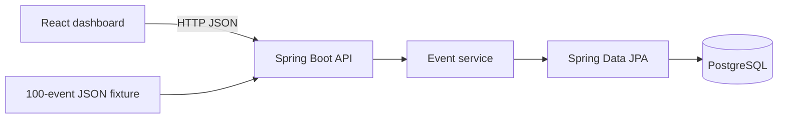

# TraceDeck: One-Day Full-Stack Project Proposal

## 1. Project Summary

TraceDeck is a local full-stack incident-investigation tool for exploring synthetic service events. It imports a deterministic set of 100 events, lets a user filter them by service and time, and reconstructs the sequence that led to a failure by grouping events with the same request ID.

The project is intentionally narrow enough to build in one focused day while supporting these resume claims:

- 4 Spring Boot REST endpoints
- PostgreSQL filtering by source and time
- React incident timelines
- 24 automated Java tests
- GitHub Actions CI
- Validation for malformed payloads and pagination
- A local benchmark comparing raw event review with TraceDeck's contextual investigation view

TraceDeck is not a production monitoring system. It does not collect real logs, authenticate users, send alerts, or replace tools such as Datadog or Splunk.

## 2. User Problem

When an error appears in a list of service events, a developer often has to search manually for earlier events associated with the same request. TraceDeck reduces that work by using a shared `requestId` to show the selected failure and the events that immediately preceded it.

The central user story is:

> As a developer investigating a service failure, I want to select an error and immediately see the earlier events from the same request so that I can identify the likely cause without manually searching the full event list.

## 3. One-Day MVP

The completed MVP contains one responsive dashboard with two investigation modes:

1. **Raw Events:** A paginated table of all events with source and time filters.
2. **Trace View:** A detail panel that shows the selected failure, its request metadata, and up to five preceding events from the same request.

The application starts with Docker Compose, seeds exactly 100 deterministic events, and can be demonstrated entirely on a laptop.

## 4. Technology Stack

| Layer | Technology | Purpose |
| --- | --- | --- |
| Frontend | React 18, Vite, TypeScript | Single-page investigation dashboard |
| Styling | Plain CSS or Tailwind CSS | Fast, responsive interface |
| Backend | Java 21, Spring Boot 3 | REST API, validation, and investigation logic |
| Data access | Spring Data JPA | Repository queries and pagination |
| Database | PostgreSQL 16 | Persistent event storage and indexed filtering |
| Local setup | Docker Compose | Starts PostgreSQL and optionally the app |
| Testing | JUnit 5, Mockito, MockMvc, H2 | Exactly 24 repeatable Java tests |
| CI | GitHub Actions | Runs backend tests and frontend build on pushes and pull requests |

## 5. System Architecture



The frontend never talks directly to PostgreSQL. Spring Boot owns validation, pagination, filtering, and context assembly. The React application only requests data and renders it.

## 6. Data Model

Use one `events` table. A separate incidents table is unnecessary for the one-day version because related events can be reconstructed by `request_id`.

| Field | Type | Description |
| --- | --- | --- |
| `id` | UUID | Unique event identifier |
| `occurred_at` | TIMESTAMPTZ | Event timestamp in UTC |
| `source` | VARCHAR(50) | Producing service, such as `checkout-service` |
| `level` | VARCHAR(10) | `INFO`, `WARN`, or `ERROR` |
| `event_type` | VARCHAR(60) | Short machine-readable event category |
| `message` | VARCHAR(255) | Human-readable summary |
| `request_id` | VARCHAR(40) | Correlation key shared by one request trace |
| `status_code` | INTEGER | Optional HTTP status code |
| `duration_ms` | INTEGER | Optional elapsed time |
| `details` | TEXT | Compact JSON string containing extra attributes |

Create these indexes:

```sql
CREATE INDEX idx_events_occurred_at ON events (occurred_at DESC);
CREATE INDEX idx_events_source_time ON events (source, occurred_at DESC);
CREATE INDEX idx_events_request_time ON events (request_id, occurred_at ASC);
```

These indexes directly support the resume claim about filtering by source and time and retrieving preceding events efficiently.

## 7. Synthetic Event Dataset

Create a deterministic `events.json` fixture containing exactly 100 events across four services:

- `web-gateway`
- `auth-service`
- `checkout-service`
- `payment-service`

Use approximately 20 request IDs with five events per request. Most requests succeed. Five or six request traces end in a meaningful error, such as:

- expired authentication token
- missing cart item
- payment timeout
- invalid postal code
- database connection failure

Each failed trace should contain a useful causal sequence. For example:

```json
[
  {
    "occurredAt": "2026-09-20T14:02:01Z",
    "source": "web-gateway",
    "level": "INFO",
    "eventType": "REQUEST_RECEIVED",
    "message": "Checkout request received",
    "requestId": "req-1042",
    "statusCode": 200,
    "durationMs": 7,
    "details": "{\"route\":\"/checkout\"}"
  },
  {
    "occurredAt": "2026-09-20T14:02:03Z",
    "source": "payment-service",
    "level": "ERROR",
    "eventType": "PAYMENT_TIMEOUT",
    "message": "Payment provider timed out",
    "requestId": "req-1042",
    "statusCode": 504,
    "durationMs": 3000,
    "details": "{\"provider\":\"sandbox-pay\"}"
  }
]
```

Use a fixed file instead of random generation so tests, screenshots, and benchmark tasks always produce the same results.

## 8. REST API Contract

Implement exactly four endpoints.

### 8.1 Import Events

`POST /api/events/import`

Accepts a JSON array of events. It validates every event before saving the batch.

Success response:

```json
{
  "imported": 100,
  "message": "Events imported successfully"
}
```

Validation rules:

- request body must be an array containing 1-500 events
- `occurredAt`, `source`, `level`, `eventType`, `message`, and `requestId` are required
- `level` must be `INFO`, `WARN`, or `ERROR`
- `statusCode`, when supplied, must be 100-599
- `durationMs`, when supplied, cannot be negative

Malformed input returns HTTP 400 with field-specific errors. Save the batch only when every item is valid.

### 8.2 Search Events

`GET /api/events?source=payment-service&from=2026-09-20T14:00:00Z&to=2026-09-20T15:00:00Z&page=0&size=20`

All filters are optional. Results are ordered newest first.

Response:

```json
{
  "content": [],
  "page": 0,
  "size": 20,
  "totalElements": 100,
  "totalPages": 5
}
```

Pagination rules:

- default page: 0
- default size: 20
- allowed size: 1-50
- negative pages or larger sizes return HTTP 400
- `from` after `to` returns HTTP 400

### 8.3 Get One Event

`GET /api/events/{id}`

Returns the full selected event, including its `details` value. An unknown UUID returns HTTP 404.

### 8.4 Get Investigation Context

`GET /api/events/{id}/context?limit=5`

Returns the selected event and up to five earlier events with the same `requestId`.

```json
{
  "selectedEvent": {},
  "precedingEvents": [],
  "requestId": "req-1042",
  "probableCause": "PAYMENT_TIMEOUT",
  "eventCount": 4
}
```

The backend calculates `probableCause` using a transparent rule: choose the earliest `WARN` or `ERROR` event in the returned trace. This is deterministic and does not pretend to use AI.

## 9. Backend Design

### Main classes

| Class | Responsibility |
| --- | --- |
| `Event` | JPA entity for the `events` table |
| `EventRequest` | Validated import DTO |
| `EventResponse` | API-safe event representation |
| `ContextResponse` | Selected event plus preceding trace |
| `EventRepository` | Filter and request-history queries |
| `EventService` | Import, search, lookup, and context logic |
| `EventController` | Defines the four REST endpoints |
| `ApiExceptionHandler` | Converts validation and not-found errors into consistent JSON |

### Filtering implementation

Use a Spring Data `JpaSpecificationExecutor<Event>` so source, `from`, and `to` filters can be combined without creating many repository methods. Apply `PageRequest` for pagination and sort by `occurredAt` descending.

### Context implementation

1. Load the selected event by UUID.
2. Query events with the same `requestId` and an earlier or equal timestamp.
3. Sort them oldest to newest.
4. Keep the selected event separate.
5. Return the last `limit` preceding events.
6. Select the earliest warning or error as the probable cause.

This logic is the main feature that distinguishes TraceDeck from a normal event table.

## 10. Frontend Design

Build one route, `/`, with the following layout.

### Header

- TraceDeck name
- subtitle: `Local service-event investigation`
- `Load demo data` button
- small API status indicator

### Summary cards

Show four values computed from the current search response:

- visible events
- errors
- unique services
- median duration

These are descriptive UI values, not resume metrics.

### Filter bar

- service dropdown with `All services` and the four known sources
- `from` datetime input
- `to` datetime input
- level dropdown implemented client-side for the current page
- `Apply filters` and `Clear` buttons

Only source and time are sent to the backend because those are the promised database filters.

### Event table

Columns:

- time
- level badge
- source
- message
- request ID
- duration

Each row has an `Investigate` action. Error rows use a restrained red accent, warnings use amber, and information events remain neutral.

### Investigation drawer

Selecting `Investigate` opens a right-side drawer containing:

- selected error summary
- request ID and status code
- probable-cause callout
- vertical timeline of up to five preceding events plus the selected event
- expandable raw `details`
- `Copy request ID` button

Timeline nodes show time, service, event type, and message. This directly supports the resume statement about presenting incident timelines in React.

### Pagination

Provide Previous and Next buttons plus `Page X of Y`. Keep the page size fixed at 20 in the interface while still validating different sizes through API tests.

### Empty and error states

- no data: explain how to load the demo dataset
- no search results: offer a Clear Filters button
- API unavailable: show a retry message
- invalid date range: display the backend's 400 error beside the filters

## 11. Suggested Visual Style

Use a clean developer-tool aesthetic:

- dark navy page background
- charcoal panels
- off-white body text
- cyan focus and selection accents
- red and amber severity badges
- monospace font only for request IDs and raw details

The design should feel like an internal engineering dashboard, but avoid recreating a specific commercial monitoring product.

## 12. Exactly 24 Java Tests

Keep the test count explicit and visible in the README.

### `EventServiceTest` - 8 tests

1. imports a valid batch
2. rejects an empty batch
3. searches without filters
4. filters by source
5. filters by time range
6. combines source and time filters
7. returns an event by ID
8. throws not found for an unknown ID

### `EventContextServiceTest` - 5 tests

9. returns preceding events with the same request ID
10. excludes later events
11. enforces the context limit
12. orders the timeline oldest to newest
13. selects the earliest warning or error as probable cause

### `EventControllerTest` - 6 tests

14. import returns HTTP 201
15. malformed import returns HTTP 400
16. search returns paginated JSON
17. invalid page returns HTTP 400
18. get event returns HTTP 200
19. unknown event returns HTTP 404

### `EventValidationTest` - 5 tests

20. rejects a missing source
21. rejects an invalid level
22. rejects a negative duration
23. rejects an invalid status code
24. rejects a `from` date later than `to`

The service tests use Mockito, controller tests use MockMvc, and validation tests use Jakarta Bean Validation. The running application uses PostgreSQL. Tests may use H2 because the queries remain portable JPA queries.

## 13. GitHub Actions CI

Create `.github/workflows/ci.yml` with two jobs:

1. **backend-test**
   - checkout
   - set up Java 21
   - cache Maven dependencies
   - run `./mvnw test`
   - fail unless all 24 tests pass

2. **frontend-build**
   - checkout
   - set up Node 20
   - run `npm ci`
   - run `npm run build`

Run the workflow on every push and pull request. Treat a successful workflow as the gate before building or sharing a deployment candidate. Do not claim continuous deployment unless an actual deployment step is added later.

## 14. Repository Structure

```text
tracedeck/
├── README.md
├── docker-compose.yml
├── data/
│   └── events.json
├── backend/
│   ├── pom.xml
│   └── src/
│       ├── main/java/com/gauri/tracedeck/
│       │   ├── controller/
│       │   ├── dto/
│       │   ├── exception/
│       │   ├── model/
│       │   ├── repository/
│       │   └── service/
│       ├── main/resources/application.yml
│       └── test/java/com/gauri/tracedeck/
├── frontend/
│   ├── package.json
│   └── src/
│       ├── api/events.ts
│       ├── components/
│       │   ├── EventTable.tsx
│       │   ├── FilterBar.tsx
│       │   ├── InvestigationDrawer.tsx
│       │   ├── SummaryCards.tsx
│       │   └── Timeline.tsx
│       ├── types.ts
│       ├── App.tsx
│       └── styles.css
├── benchmark/
│   ├── tasks.md
│   ├── results.csv
│   └── calculate.py
└── .github/workflows/ci.yml
```

## 15. Local Run Flow

The README should provide these commands:

```bash
docker compose up -d db
cd backend && ./mvnw spring-boot:run
cd frontend && npm install && npm run dev
```

The demo sequence is:

1. Open the React app.
2. Click `Load demo data` to import the 100-event fixture.
3. Filter to `payment-service` and a narrow time range.
4. Select a `PAYMENT_TIMEOUT` error.
5. Open the investigation drawer.
6. Show the preceding request events and probable cause.
7. Change pages and demonstrate an invalid date range.
8. Show the GitHub Actions run with all 24 tests passing.

## 16. Benchmark for the 35% Claim

The benchmark must be run after the feature is complete. Do not hard-code or assume a 35% result.

### Comparison

- **Baseline mode:** raw paginated events with source and time filters; no context drawer
- **TraceDeck mode:** the same data and filters plus the investigation timeline

### Dataset

Use the same 100-event fixture. Prepare six investigation tasks, such as:

- identify the event immediately preceding `PAYMENT_TIMEOUT`
- determine which service first warned during request `req-1042`
- find the earliest causal event in a database-failure trace

### Procedure

1. Recruit at least three classmates or friends if possible.
2. Give each person three baseline tasks and three TraceDeck tasks.
3. Alternate task order between participants to reduce learning bias.
4. Start timing when the task is displayed.
5. Stop when the participant states the correct event type and service.
6. Record incorrect answers as incomplete rather than manipulating the time.
7. Calculate the median completion time for each mode.

Formula:

```text
improvement_percent = ((baseline_median - tracedeck_median) / baseline_median) * 100
```

Example only:

```text
baseline median: 40 seconds
TraceDeck median: 25 seconds
improvement: 37.5%
```

Replace the resume's 35% with the measured result. If the measured result is below 35%, use the actual number. If no benchmark is completed, change the resume bullet to describe the benchmark design without claiming an improvement.

## 17. One-Day Build Schedule

This assumes approximately 10 focused hours and use of code-generation assistance for boilerplate.

| Time | Deliverable |
| --- | --- |
| 8:00-8:45 | Scaffold Spring Boot, React/Vite, PostgreSQL, and Docker Compose |
| 8:45-9:45 | Create entity, schema, indexes, DTOs, and 100-event fixture |
| 9:45-11:15 | Implement the four endpoints, validation, filtering, and context logic |
| 11:15-12:00 | Manually verify all endpoints in Postman or Swagger |
| 12:00-1:00 | Break and buffer |
| 1:00-2:30 | Build dashboard, filter bar, table, and pagination |
| 2:30-3:30 | Build investigation drawer and timeline |
| 3:30-5:00 | Write and verify exactly 24 Java tests |
| 5:00-5:30 | Add GitHub Actions and confirm a clean run |
| 5:30-6:15 | Add benchmark files, README, screenshots, and final polish |

If time becomes tight, preserve the four endpoints, timeline, tests, and CI. Drop summary cards, Tailwind, animations, and advanced visual polish first.

## 18. Definition of Done

TraceDeck is complete when all of these are true:

- Docker Compose starts PostgreSQL successfully.
- The import endpoint loads exactly 100 deterministic events.
- The search endpoint filters by service and timestamp range.
- Pagination rejects invalid page and size values.
- A user can select a failure and see preceding events for the same request.
- The React timeline shows time, source, level, event type, and message.
- Malformed payloads return consistent HTTP 400 responses.
- Unknown event IDs return HTTP 404.
- Exactly 24 Java tests pass locally and in GitHub Actions.
- The React production build passes in CI.
- The README explains setup, API endpoints, architecture, test count, and benchmark method.
- Any resume performance metric matches the benchmark's actual result.

## 19. Explicit Non-Goals

Do not add these during the one-day build:

- authentication or user accounts
- live log streaming
- Kafka or RabbitMQ
- AI-generated root-cause analysis
- alerting, email, or Slack integrations
- microservice deployment
- Kubernetes
- cloud hosting
- editable events
- charts beyond the simple summary cards

These additions would make the project look broader but reduce the chance of finishing a coherent, testable application in one day.

## 20. Resume Evidence Map

| Resume statement | Required repository evidence |
| --- | --- |
| 4 Spring Boot REST endpoints | Four controller mappings and README API table |
| filters synthetic events by source and time in PostgreSQL | JPA specification, PostgreSQL indexes, and demo fixture |
| presents incident timelines in React | Timeline and investigation drawer components |
| 24 automated Java tests | Exactly 24 named passing tests and CI output |
| validates ingestion, pagination, and malformed payloads | Import, controller, pagination, and validation tests |
| GitHub Actions CI | Passing workflow on push or pull request |
| reduced investigation time by 35% | Raw results, calculation script, and measured result at or above 35% |

The repository should make every resume claim easy to verify in under two minutes.
